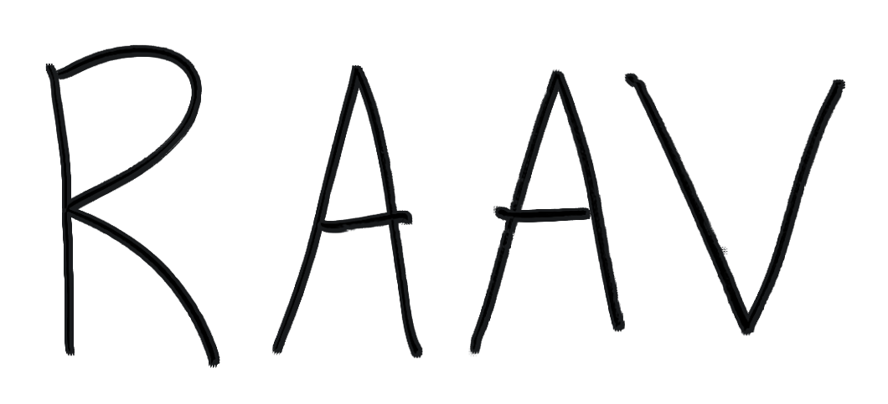
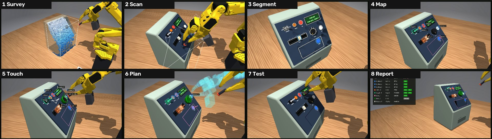
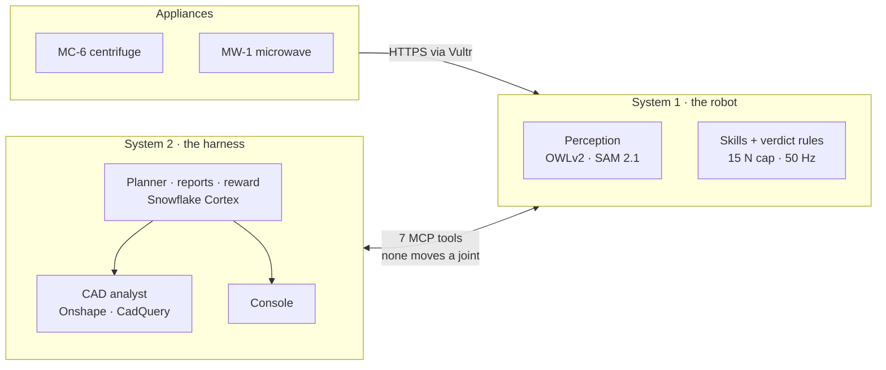

<p align="center">
  <picture>
    <source media="(prefers-color-scheme: dark)" srcset="docs/assets/logo.png">
    
  </picture>
</p>

<h3 align="center">Robot As A Verifier</h3>

<p align="center">
  <b>A verifier for hardware.</b> Give it a prototype, its manual and its CAD if you have one.<br>
  A low-cost robot arm finds every control, tests it with capped force, and reports what it measured.<br>
  A fix only counts if the score goes up.
</p>

<p align="center">
  <code>SO-101 + $19 wrist camera</code> · <code>7 MCP tools</code> · <code>15 N hard cap</code> · <code>4 frontier models</code>
</p>

<p align="center">
  <a href="#get-running">Get running</a> ·
  <a href="docs/system-boundary.md">System 1 and System 2</a> ·
  <a href="docs/devpost.md">Devpost write-up</a> ·
  <a href="docs/pitch/README.md">Pitch</a> ·
  <a href="PLAN.md">Plan</a>
</p>

<p align="center">
  
  <br><sub>The pipeline on a device it was never tuned on. Simulation (MuJoCo).</sub>
</p>

A verifier for autonomous hardware R&D. Give it a product, its instruction manual and (if you have one) its CAD. A robot arm with pressure and touch sensing explores the product, tests every control, and writes bug reports backed by force traces and frames. You can steer the run from a web console at any time, trace a bug back to the exact failure, and optionally send a fix to the CAD. The fix only counts if the same tests score higher on the new print.

Built by Karthik, Joseph, Max and Bayan for MakeCU 2026 (Columbia, Nov 7 to 8).

> **Status, Nov 8.** In simulation, the pipeline passes 110 of 115 attempted tests (96%) on 16 devices it was never tuned on, with 0 false failures. The full loop also runs end to end there: a model plans from the manual, a person approves, the arm tests, the CAD analyst patches, and the retest scores higher. On the real SO-101, the arm scans the real MC-6, flips POWER, turns SPEED and presses START while the Arduino reports what changed. Still to show: a patched part printed and retested on the real arm. See [PLAN.md](PLAN.md) and [the Devpost write-up](docs/devpost.md).

## The rule: the model thinks, code moves, sensors decide

Whatever proposes a plan or a fix has no say in how it's scored. The LLM can plan, steer and explain, but it can't move a joint, can't override a verdict and can't approve its own CAD patch.

| | Step | What happens |
|---|---|---|
| 1 | **Find controls** | One wrist camera. OWLv2 finds parts, SAM 2.1 outlines them, a plane sweep gives heights, and a touch pins each one down. No CAD or tags needed |
| 2 | **Plan from the manual** | A model turns the manual into steps. A person approves before anything moves |
| 3 | **Test with force** | `press`, `flip`, `turn`, `hook_pull`, `pick`, `place`. Every step ends on force and on what the appliance reports over Wi-Fi |
| 4 | **Trace to CAD** | A CAD analyst finds the root cause in the geometry, edits only the faulty part, and must pass geometry checks. A person approves |
| 5 | **Retest** | Same plan on the new revision. Reward is control coverage × pass rate, recomputable from the logs |



## Two systems

**Read [System 1 and System 2](docs/system-boundary.md) before adding code.** It says which system your change belongs to.

| | [`system-1/`](system-1/README.md): the robot | [`system-2/`](system-2/README.md): the harness |
|---|---|---|
| Does | Perception, IK, control, skills, verdict rules, safety, local retries | LLM calls, slash commands, planning, memory, reward, reports, CAD, Console |
| AI | Almost none: classifiers, IK, fixed policies. Never calls an LLM | The only place an LLM is called |
| Starts work | Only when System 2 starts a routine | When a person starts a run |
| Demo machine | Joseph's Windows laptop | Joseph's laptop or Karthik's Mac |

They talk through [seven tools](docs/system-boundary.md#control-what-system-2-can-call) over MCP, and each has its own install. System 2 can start routines, but it has no tool that moves a joint. [`docs/`](docs/README.md) holds what both sides need to read, and the pitch.

## Highlights

From [the Devpost write-up](docs/devpost.md). Simulation unless stated.

| | Result |
|---|---|
| **Held-out devices** | 110 of 115 attempted tests passed (96%) on 16 devices never tuned on, with 0 false failures |
| **The full loop, MC-6** | A tube stopped 8.15 mm above its seat. The CAD analyst (Opus 5.5, 14 tool calls, 102 s, $0.43) widened a bore 0.4 mm too narrow and added a 45° lead-in. On retest it seated within 0.97 mm, within 0.2 mm of the designer's own fix, which it never saw |
| **Reward rises** | Interval timer with 3 planted faults: 2 found, patched, reward 0.42 → 0.64 |
| **Force from servos alone** | 0 → 84 of 89 steps, with no added sensor |
| **A $19 camera** | Outlines within 0.41 mm, heights within 1 mm 93 to 95% of the time |
| **Four models, one endpoint** | Claude Haiku 5.5, Claude Sonnet 5.5, GPT-5.4 and Grok 4.7 through Snowflake Cortex. The model is one config value |
| **Real arm** | The SO-101 scans the real MC-6, flips POWER, turns SPEED and presses START while the Arduino reports what changed |

## Appliance firmware

The current MC-6 centrifuge and MW-1 microwave board project is in [`firmware/`](firmware/README.md). Each appliance has its own **Arduino Uno R4 WiFi** and upload target: `mc6` or `mw1_r4_wifi`. Open `firmware/` as its own VS Code/PlatformIO project, or run builds from that directory. It includes the sketches, button discovery, saved calibration records, serial monitors and host tests.

The existing appliance-local firmware files remain older snapshots. Use the top-level `firmware/` project for the current physical boards; the simulation device definitions remain in `appliances/`.

## Get running

You need [uv](https://docs.astral.sh/uv/). It installs Python 3.12 for you.

```bash
cd system-2
uv sync                    # the light install: harness, CAD params and tests
uv run rav mock            # the full demo story with a fake System 1: Rev A, 2 bugs, patch, Rev B, reward 0.60 -> 1.00
uv run pytest              # no hardware, GPU or network needed
```

To run the two systems for real, in two terminals:

```bash
cd system-1 && uv sync --extra sim && uv run rav-server --robot sim --depth    # waits for System 2
cd system-2 && uv sync && uv run rav run                                       # one full run
```

To reach System 1 on another machine, start the server with `RAV_TOKEN=<secret>` and `--host 0.0.0.0`, then run `RAV_TOKEN=<secret> uv run rav run --url http://<its address>:8780/mcp`.

For the appliance HTTPS endpoint and System 2 on Vultr, see [the reverse WebSocket setup](deploy/vultr/README.md).

Each run writes `system-2/runs/<id>/events.jsonl` and `report.json`. The Console renders those files.

Add what you work on:

| You work on | In | Install | Then |
|---|---|---|---|
| Sim, perception, skills | `system-1` | `uv sync --extra sim` | `cd sim` for Joseph's film and benchmark tools |
| Real cameras | `system-1` | `uv sync --extra sim --extra phone` | [`real_wrist.py`](system-1/hardware/real_wrist.py) for the wrist (Windows only), [`real_cameras.py`](system-1/hardware/real_cameras.py) for the run's video and the dropped iPhone |
| Real arm | `system-1` | `uv sync --extra sim --extra arm` | [`system-1/arm`](system-1/arm/README.md) |
| The tools | `system-1` | `uv sync` | [`system-1/server`](system-1/server/README.md) |
| Planner, analyst, memory | `system-2` | `uv sync --extra model` | [`system-2/harness`](system-2/harness/README.md) |
| CAD | `system-2` | `uv sync --extra cad` | [`system-2/cad`](system-2/cad/README.md) |
| Console | `system-2` | `npm install` in `console/web` | [`system-2/console`](system-2/console/README.md) |

## Which source to trust

| For | The source of truth is |
|---|---|
| Who does what, and status | [Kanban](https://claude.ai/artifact/9Dm3x26boTyvHhrqAyEpaV) |
| The split between the systems, to share | [System 1 and System 2](https://claude.ai/artifact/6d9gQhE7LqDb9xUeMPYPDa) |
| Current architecture, interfaces and decisions | This repo: [`docs/`](docs/README.md) and [`docs/decisions.md`](docs/decisions.md) |
| Research, bill of materials, reasoning and history | [Google Doc](https://docs.google.com/document/d/1fRen3rUlAyUSO0AACiKA1Zz-LrHpg4sqn350Y-rfYi0/edit) |
| What the finished product should look like | [Self-Evolving Hardware mockup](https://claude.ai/artifact/2wY8eCvh5VkNb8QSE98Sum) |
| The harness principles this draws on | [Self-Evolving Robots](https://claude.ai/artifact/VxmRPoiAXK3pCHxKmjgRv6) |
| Sim results as shown to others | [Robot Product Tester](https://claude.ai/artifact/Fia1Xqk11wDS5uwNQLh3ci) |

If two of these disagree on something current, the repo wins. Fix the other one or add a line to [`docs/decisions.md`](docs/decisions.md).
