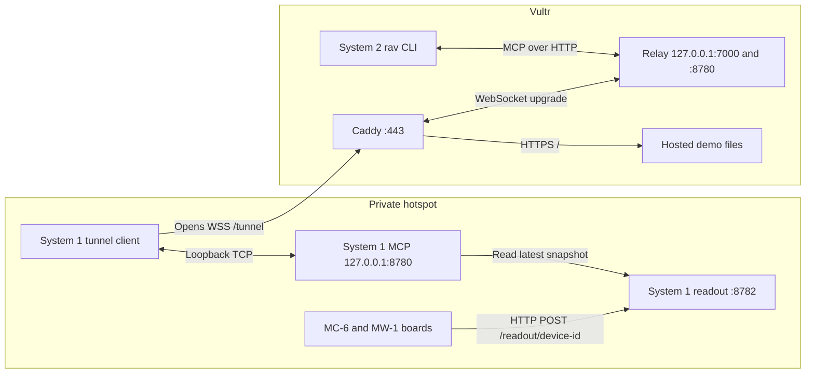

# System 1 on a hotspot and System 2 on Vultr

System 1 and the appliances share a private hotspot. The appliances post snapshots directly to System 1 on port 8782. System 1 opens one outbound WSS connection to Vultr, where Caddy terminates TLS on 443 and exposes `/tunnel`. The relay forwards Vultr's `127.0.0.1:8780` to System 1's `127.0.0.1:8780` for the harness's existing Streamable HTTP MCP client.



The WebSocket carries MCP requests and responses once System 1 connects. Appliance publishing continues if the tunnel or VPS goes down. The hosted browser console replays bundled runs. For current robot status or appliance data, use the harness on Vultr.

| Credential | Where it belongs | What it permits |
|---|---|---|
| Tunnel token | Relay and System 1 tunnel client | Register the outbound WebSocket |
| `RAV_TOKEN` | System 1 server and System 2 harness | Call the MCP tools, including robot routines |
| `RAV_DEVICE_KEYS` | System 1 server | Map board IDs to their individual readout credentials |
| `DEVICE_KEY` | One Arduino's ignored `arduino_secrets.h` | Access only that board's local readout route |

Keep the three types of credentials distinct. Keep the hotspot private and password-protected. The board-to-System-1 hop uses plain HTTP, while the VPS hop uses certificate-verified TLS.

- [Firmware publisher](../../firmware/firmware/rav_wifi.h) sends snapshots with the board ID in the URL.
- [System 1 readout API](../../system-1/server/src/rav_server/device_api.py) validates the credential, ingests the snapshot and reports its age.
- [Tunnel client and relay](tunnel.py) carry the existing MCP HTTP traffic over one WebSocket. They forward TCP streams without interpreting MCP messages.
- [System 2 MCP client](../../system-2/harness/src/rav_harness/client.py) calls System 1 through the relay's loopback port.

## Vultr

1. Install Caddy 2.11 and Python 3.12 or 3.13. Allow inbound TCP 443 in the host and cloud firewalls. Open TCP 80 if you want the bare address to redirect to HTTPS or need the ACME HTTP challenge. Run System 2 on the VPS host so it can reach the relay's loopback listener.
2. Create a venv at `/opt/rav-tunnel` with `python3 -m venv /opt/rav-tunnel`. Copy `tunnel.py` into it and install `requirements.txt` with `/opt/rav-tunnel/bin/python -m pip install -r requirements.txt`. Put a generated random tunnel token (at least 32 URL-safe characters) in `/etc/rav/tunnel-token`, readable only by root. Install `rav-tunnel.service` under `/etc/systemd/system` and run `sudo systemctl daemon-reload` followed by `sudo systemctl enable --now rav-tunnel`.
3. Install the Caddyfile or add its site block to the existing configuration. Set `RAV_PUBLIC_HOST` in Caddy's service environment, validate the config with that variable set, then start or reload Caddy. Both relay listeners bind to loopback.
4. From `system-2`, run `uv sync --locked --no-dev`. The deployment checkout also needs `system-1/interface`, which System 2 uses for the wire contracts. Set `RAV_TOKEN` in the harness environment to the same value as on System 1.

For a DNS hostname, point its record at the VPS and let Caddy manage HTTPS. For a public IP, set `RAV_PUBLIC_HOST` to the IP and put this TLS block inside the Caddy site block. Caddy handles certificate renewal. The TLS-ALPN challenge needs TCP 443 to reach Caddy. [Let's Encrypt IP certificates](https://letsencrypt.org/2026/01/15/6day-and-ip-general-availability)

```caddyfile
tls {
    issuer acme {
        profile shortlived
        disable_http_challenge
    }
}
```

### Browser console

From `system-2/console/web`, run `npm ci` and `VITE_CONSOLE_READ_ONLY=1 npm run build`. Install the contents of `dist/` under `/var/www/rav-console`. The hosted demo serves bundled projects and recorded runs. Live robot control and project writes require a separate authenticated backend.

## System 1

Copy the tunnel token into a private local file and set `RAV_TUNNEL_TOKEN_FILE` to its absolute path. From the repository root, run the client with `uv` or install `requirements.txt` into a dedicated Python environment and run the same script directly:

```powershell
uv run --no-project --with-requirements deploy/vultr/requirements.txt python deploy/vultr/tunnel.py client --url wss://robot.example.edu/tunnel
```

The client retries after a connection loss. A dropped connection can interrupt an in-flight MCP call. Check the robot's status after reconnecting before deciding whether to repeat a command.

Join the hotspot and find System 1's IPv4 address on that network. Set `RAV_TOKEN` and `RAV_DEVICE_KEYS` in the System 1 server environment. The latter is a JSON object mapping each stable device ID to its own random 32–128 character URL-safe credential. Start with the mock robot from `system-1`, substituting the actual address:

```powershell
uv run rav-server --robot mock --telemetry-port 0 --device-host 192.168.43.10
```

Allow inbound TCP 8782 on System 1 for the hotspot network if its firewall blocks it. The hotspot must allow its clients to talk to each other. If the hotspot changes System 1's address, update `--device-host` and the boards' `RAV_HOST`.

For a supervised hardware run keep `--device-host` and use `--robot real --arm-port COM5 --calibration <file> --readout http --readout-device mc6-01` with the actual port, calibration and device ID. The selected appliance supplies the real robot's readout. Other registered appliances remain available for inspection. System 1 must have a fresh snapshot before it can use the selected appliance's data.

## Appliances

Both PlatformIO targets use an Arduino Uno R4 WiFi and the same snapshot publisher. Copy each board's example to `arduino_secrets.h` beside its sketch. The sketch enables Wi-Fi when that file exists.

| Board | PlatformIO target | Default example ID | Configuration |
|---|---|---|---|
| MC-6 centrifuge | `mc6` | `mc6-01` | [MC-6 secrets example](../../firmware/MC6_firmware/arduino_secrets.h.example) |
| MW-1 microwave | `mw1_r4_wifi` | `mw1-01` | [MW-1 secrets example](../../firmware/MW1_firmware/arduino_secrets.h.example) |

Set the same hotspot SSID, password, System 1 IP and port 8782 in both files. Give each board a distinct ID and key that match its own entry in `RAV_DEVICE_KEYS`. A serial `wifi` event with value `204` means System 1 accepted that board's snapshot. On Vultr, use `rav readout mc6-01` and `rav readout mw1-01` to verify both.

The firmware sends complete, flat JSON snapshots on changes and periodically. Short transitions can fall between sends. Joining Wi-Fi or opening a connection can block the firmware loop, especially during outages. Bench-check button and sensor timing with Wi-Fi enabled before using it in a run.

Use the top-level `firmware/` PlatformIO project for both boards. On the MC-6, wire the tube sensor to **A1** and the lid sensor to **A2**. The current bench configuration uses the lid sensor and leaves the tube requirement disabled. Recalibrate after swapping the sensor pins, since saved thresholds are tied to the pin assignment.

## Smoke test

From `system-2` on Vultr, with System 1 running in mock mode and the tunnel connected:

```sh
uv run rav status
uv run rav readout
uv run rav readout mc6-01
```

Send a test snapshot from a machine on the hotspot with the registered device credential, or power up the board:

```sh
curl -fsS "http://${SYSTEM1_HOTSPOT_IP}:8782/readout/mc6-01" \
  -H "Authorization: Bearer ${MC6_KEY}" -H 'Content-Type: application/json' \
  --data '{"speed":1000,"lid":1,"LCD":"READY"}'
```

Run `uv run rav readout mc6-01` on Vultr. Expect `fresh: true` while a board is posting, and `false` after two seconds without updates. For a single manual POST, verify the sample values even if the CLI starts after the freshness window. The same key should receive 401 on a different device's POST route. Public `/mcp` and `/readout/mc6-01` should return 404. Stop the tunnel and confirm the board still gets 204. Reconnect and run `rav status` again.

| Symptom | Check |
|---|---|
| Browser shows the demo but live controls are unavailable | This is the static console. Use `rav status` and `rav readout` on Vultr for the live connection. |
| `rav status` cannot connect | Check `journalctl -u rav-tunnel -u caddy` on Vultr and the System 1 tunnel log. Verify the certificate, tunnel token, MCP token, and System 1's loopback listener. |
| Arduino gets no response | Check its hotspot connection, System 1's hotspot IP, TCP 8782, and whether the hotspot isolates its clients. |
| Arduino gets 401 | Verify the ID in the URL and its matching `RAV_DEVICE_KEYS` entry. |
| System 2 sees an old snapshot | Check `age_s` and `fresh`. System 1 retains the last sample for inspection and refuses stale Wi-Fi readings for real-arm verdicts. |
