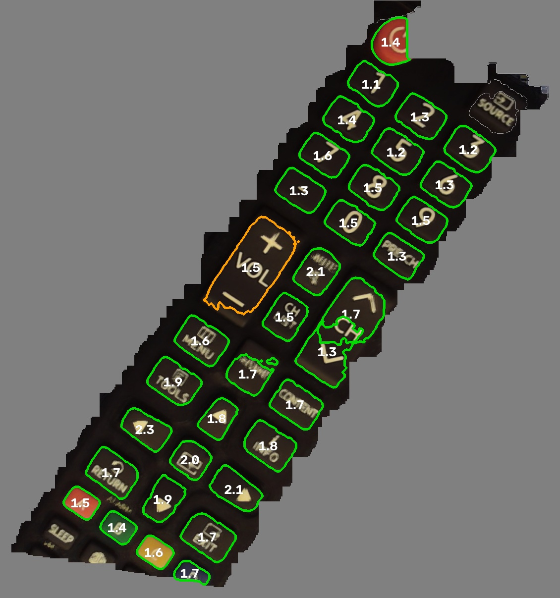
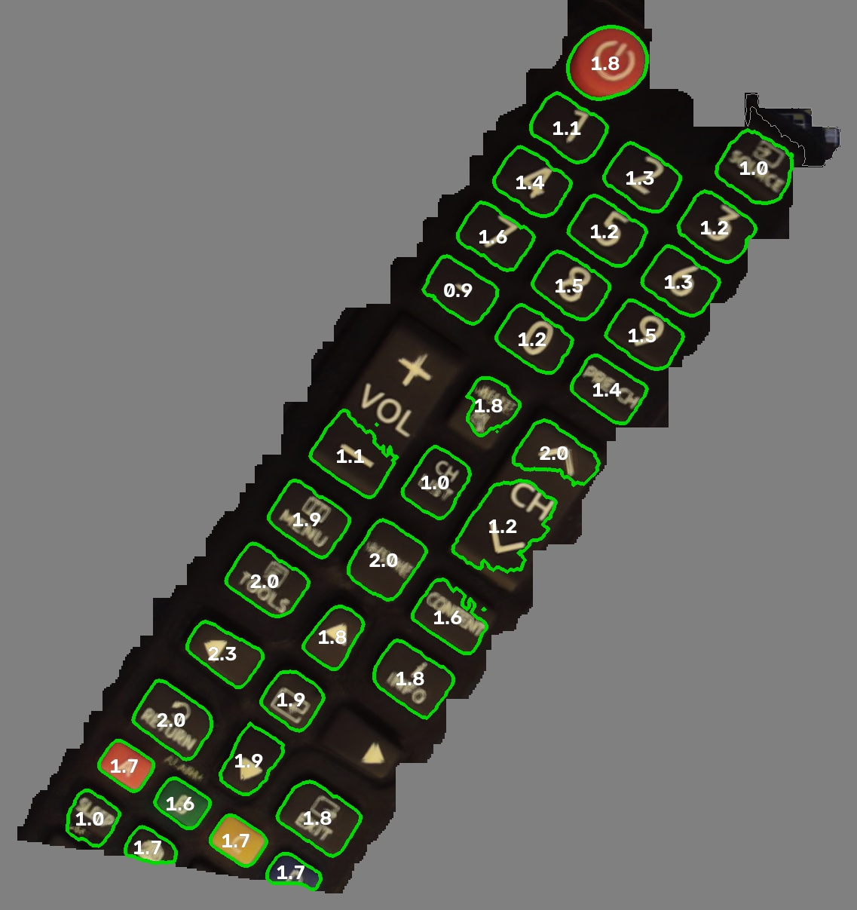

# Wrist camera results: Innomaker U20CAM-1080p-S1

Measured on Nov 6, 2026, against the sim's camera model (`system-1/sim/sensors.py`, `USB_*`). How to run each step is in [README.md](README.md). Paths under `camera_out/` are local outputs; git keeps `calib.json`, and the plots referenced from `img/`.

## Step 1: info

| | Measured | Sim assumes | Matters for the setup? |
|---|---|---|---|
| MJPEG modes at 30 fps | 640x360 up to **1920x1080**, plus a 4:3 1280x960 | 1280x720 MJPEG at 30 | Possibly: 1080p at 30 fps could give the scan 1.5x the detail, if it shows the same view (see the crop check) |
| Uncompressed (YUY2) | 1280x720 at 10 fps max, 1920x1080 at 5 | "10 fps at that size" | No. Use MJPEG |
| **MJPEG quality** | **about 51** | 80 (a guess) | **Yes.** Stronger compression than modelled: more 8x8 block artifacts and less fine texture, which the height sweep relies on. The sim should use 51 |
| Focus control | None (autofocus and focus not exposed) | A fixed lens, focused by screwing it in | Matches. Focus is set by hand, once |
| Exposure and white balance | Both writable (exposure -6, i.e. 2^-6 s = 16 ms; white balance 4600 K, auto on by default) | Locked | Matches, if the code locks them. They default to auto |
| **Frame rate through OpenCV** | **DirectShow: stuck at uncompressed 1280x720 at 10 fps** whatever is requested. **Media Foundation (`cv2.CAP_MSMF`): 30 fps** | 30 fps | **Yes.** On Windows, open the camera with `cv2.CAP_MSMF`, or LeRobot's OpenCV camera may run at 10 fps. Check its backend setting |

## Step 2, attempt 1: lens calibration on the laptop screen (not trusted)

25 views of an 11x7 board on the laptop. RMS reprojection error 1.22 px (good is under about 0.5).

| | Standard model (5 coefficients) | Rational model (8 coefficients) | Sim |
|---|---|---|---|
| RMS error | 1.19 px | 1.17 px | n/a |
| Focal length | 831 px | 831 px | **621 px** |
| Image centre | (621, 375) | (623, 374) | (650, 355), a guess |
| Field of view, horizontal | 75° | 95° | 104° |

What this attempt shows:
- **The board never reached the image edges.** Detected corners span x = 173 to 1133 of 1280, and fill 81 of 144 grid cells. The outer edges, where this wide lens distorts most, were never measured. So the edge distortion, and with it the field of view, is extrapolated: two models fitting the same data disagree by 20°.
- **The 1.2 px error comes from the data, not the model.** A richer model barely helps (1.19 to 1.17 px). Likely causes: motion blur at 10 fps (DirectShow fell back to uncompressed), the screen viewed close up, and defocus.
- **The focal length is steady at 831 px in every model.** It's set by the middle of the image, where coverage was good, so it's probably real. It's 34% longer than the sim's 621. The sim derived 621 assuming the 720p image is the whole 1080p sensor scaled down. If 720p is instead a centre crop, the focal length is longer and the view narrower, which fits. The crop check below tests this directly.

### The report on attempt 1

[`img/calib_report_laptop_attempt1.png`](img/calib_report_laptop_attempt1.png) plots it:
- Every corner sits in the middle of the frame. The outer 15% on each side is empty.
- Six of the 24 views have errors of 1.5 to 3.7 px (motion blur at 10 fps). The rest are 0.2 to 1 px.
- The uncertainty map shows tens to hundreds of pixels near the edges. The edge distortion is a guess.

The fix is in the tablet run: a live preview with a coverage grid to fill, captures only when the board is held still, and 30 fps.

## Step 3: lens calibration on the Galaxy Tab S9 FE (final)

Two runs on the tablet, 9x6 squares of 23.7 mm, captured through ffmpeg at 30 fps. Three blurry views (0.79 to 1.44 px each, against a median of 0.19) were dropped, and the runs combined.

| | Views | Error | Focal (px) | Centre (px) | FOV h / v / d | Uncertainty median / corners / worst |
|---|---|---|---|---|---|---|
| Run 1 | 23 | 0.15 px | 825 | (642, 374) | 96.9 / 51.2 / 113.8° | unstable: resampled refits put the corners thousands of px apart |
| Run 2 | 48 | 0.38 px | 828 | (640, 373) | 97.3 / 51.4 / 114.1° | 1.2 / 1.2 / 9 px |
| **Final: both, blurry views dropped** | **68** | **0.20 px** | **824** | **(640.7, 373.8)** | **97.2 / 51.4 / 114.0°** | **0.85 / 0.75 / 3.4 px** |

The final calibration is in `camera_out/calib.json` (OpenCV's rational model: k1 to k6, p1, p2), with plots in `camera_out/calib_report.png` (720p; the 1080p one is below). Run 1 shows why a low error alone isn't enough: 23 views fit to 0.15 px but couldn't pin down the edges. The bootstrap uncertainty overstates the error a little, since it includes small overall shifts of the image that the board's pose absorbs in use.

### What this changes for the sim

| | Real camera | Sim | Effect |
|---|---|---|---|
| Focal length | **824 px** (a 3.7 mm lens on the 1080p sensor scaled to 720p) | 621 px (2.8 mm) | The picture is magnified 1.33x: more pixels per mm on the panel, a smaller patch of panel per photo |
| Field of view | **97° x 51°** | 104° x 63° | The vertical view is 12° narrower. At 12 cm a photo covers about 27 x 11.5 cm of panel, against the sim's 31 x 15 cm, so the scan may need more viewpoints to cover a device |
| Image centre | (641, 374) | (650, 355) | 19 px lower than the sim's guess |
| JPEG quality | 51 | 80 | More compression artifacts |
| 720p view | The whole sensor, scaled down | The same | Matches |

To do in the sim: set `USB_CAL_K` and `USB_CAL_DIST` from `calib.json`, refit `USB_LENS` to the measured projection (f 824 px), set `USB_JPEG_Q = 51`, then rerun the perception benchmark and check the scan's view planning still covers a whole device.

## Step 5: focus sweep

Blur (Gaussian-equivalent px) against distance to the tablet board, as shipped, without refocusing:

| Distance | 8-10 cm | 12-14 cm | 18-20 cm | 24-26 cm | 30-40 cm | 46-56 cm |
|---|---|---|---|---|---|---|
| Measured | 0.63 | 0.49 | 0.36 | 0.24 | 0.23 | 0.26-0.27 |
| Sim (focus at 12 cm) | 0.81 | 0.61 | 0.85 | 1.03 | 1.16-1.27 | 1.33-1.40 |

- **No refocusing needed.** At the scan distance, 12 cm, blur is 0.49 px, sharper than the sim's 0.61 px at its assumed perfect focus. The calibration stands.
- **Focus is broad, somewhere around 25 to 45 cm.** The minimum is flat (0.23 to 0.27 px from 24 to 55 cm), so "33 cm" is just the lowest bin. Distances rest on the board's assumed 23.74 mm squares (the tab's advertised 10.9" diagonal, image shown pixel for pixel), which can be checked with a credit card (85.60 mm, 3.6 squares).
- **The depth of field is far deeper than the sim's model** (a short 3.7 mm lens, and 1080p scaled to 720p). For the sim: move `USB_FOCUS_M` to about 0.35, and reduce the defocus growth so blur stays under about 0.65 px from 8 to 55 cm.

## Step 6: noise

Frame-to-frame noise (green channel, DN on a 0-255 scale), exposure and white balance locked, two runs agreeing to about 0.1 DN:

| Brightness | 8-24 | 40-56 | 88-136 | 152-200 | 216-248 |
|---|---|---|---|---|---|
| Measured | 1.0-1.1 | 1.3 | 1.6-1.9 | 1.4-1.6 | 1.4-1.8 |
| Sim | 1.9 | 1.3 | 1.2 | 1.15 | 1.1 |

- **The sim's model is in the right range.** Noise of about 1.5 DN is small, and won't be what limits the height measurement.
- **Mid-tones and highlights are about 30% noisier than modelled**, like a sensor collecting about 6,000 electrons at white instead of 11,000. For the sim: `USB_WHITE_E` about 6000.
- **Darks are quieter than modelled.** That's likely the quality-51 JPEG rounding small changes in flat dark areas to the same value, which also erases faint texture there.
- The bumps at 24-40 and 88-104 are probably bar edges seen through tiny camera shake.

## Step 7: real controls (a Samsung TV remote)

`camera_out/seg_*.jpg`: yellow is OWLv2 box then SAM outline; cyan is SAM's own automatic search for parts. These are the robot's two sources of part outlines, on raw frames, without the stitching, straightening or height check that come after.

- **The first try was dark and yellow-tinted** (brightness 52-60 of 255) because the noise test had locked exposure at 16 ms and white balance at 4600 K, and the camera keeps UVC settings until unplugged. Taken from 30-40 cm, the buttons were only 20-30 px across. OWLv2 found only the big rockers; SAM's search added most of the top keys and 1-6.
- **The second try** (auto exposure back on via `camera_test.py exposure auto`, more light, 12-15 cm away): brightness 108-119, sharpness about 7x. **Nearly every button gets its own clean outline**: numbers, VOL and CH, MUTE, CH LIST, MENU, HOME, CONTENT, TOOLS, INFO, the arrow pad, RETURN, EXIT, A to D, SLEEP, CC and the transport keys.
- **The stray outlines** (blanket, box, cables, laptop, the remote's whole body, the printed "+" and "ALARM") are what later stages remove: the survey limits the scan to the device, oversized regions are dropped, and the height check rejects flat printing (with a small risk, since printed marks can read 0.6-2.2 mm proud in stereo).
- **Rockers** (VOL, CH) are one part pressed at either end. The sim has no such kind yet.

Lessons for the rig: **light matters more than anything else here**, and exposure should be set for the rig's lighting and then locked, since the arm stops for each photo.

## Scan pipeline test 1: heights from photos alone (`height_test.py`)

A single quarter and a stack of three on the tablet's calibration board. The board gives each handheld photo's camera position, standing in for the arm's joint readings. Twenty photos from 12-15 cm, then a plane sweep: every photo is projected onto each candidate height from -1 to 9 mm in 0.05 mm steps, and each spot gets the height where the photos agree best. Spots with almost no texture are marked unmeasurable.

| | Measured | Expected | |
|---|---|---|---|
| Single quarter | 2.00 mm (spread 0.08) | 1.75 mm + glass | |
| Stack of three | 5.40 mm (spread 0.06) | 5.25 mm + glass | |
| **Stack minus single** | **3.40 mm** | **3.50 mm** | **0.10 mm error** |
| Single's diameter | 24.9 mm | 24.26 mm | |

- **Heights are accurate to about 0.1 mm** with the real camera, JPEG quality 51 and good light: in line with the sim's 0.18 mm median, and ample for buttons 1-3 mm proud.
- Both coins read 0.15-0.25 mm high. That's mostly refraction: an image under about 0.5 mm of glass appears raised by t(1 - 1/n), about 0.17 mm.
- **The first attempt failed** (warm, dim light: dark coins with no usable texture, plus the stack sliding 6 mm mid-capture). Light again made the difference.
- A synthetic version of the same test (rendered board and coins through the real calibration, JPEG 51; the script isn't committed) recovers both heights to within 0.05 mm, and showed two things the method needs: plain areas must be rejected (JPEG makes them agree at every height), and coins must be outlined from confident cells with gaps closed.

## Scan pipeline test 2: a TV remote, end to end (`scan_test.py`)

A Samsung TV remote lying across the tablet's board, 20 handheld photos from 15-20 cm, board-measured camera positions. The robot's steps on real photos:
1. Heights by plane sweep from the board up to 35 mm: the remote's top at about 24.9 mm, the board flat at 0.0.
2. A straight-on picture of the remote at its top surface, cropped to it, 0.1 mm per pixel, with everything else greyed out.
3. Outlines from OWLv2 + SAM and SAM's own search: 24 regions.
4. Each region's height above the remote's surface near it.
5. A kind for each.

**Result: 20 buttons and 2 flat parts**, in the middle 47 x 83 mm of the remote. All of 0-9, VOL, CH, TOOLS, INFO and the arrow keys are outlined and called buttons, 0.5-1.9 mm high (mostly 0.7-1.3), which is the right range for rubber keys. The board, the body and the printing were all rejected as flat. `camera_out/scan/scan_map.jpg` has the labelled picture.

Where it falls short:
- MENU got no outline, and CH LIST was called flat.
- The rockers (CH, VOL) split into two parts each, with different heights. The sim has no rocker kind.
- **Heights are noisier than the coins**: number keys that should match range 0.5-1.3 mm (about ±0.4 mm, against 0.1 mm on the coins). The remote's plain black body gives the camera almost nothing to measure the surface from between buttons. On the rig, the touch step (tapping bare panel) is what fixes the surface. Here it's estimated from the lowest confident readings within 12 mm, outside every outline, on the remote only.
- No ground truth for the remote's key heights.

**Rerun over the whole board (gap filling widened from 15 to 31 cells).** The first result above covered only 47 x 83 mm because a band of bare plastic between key rows split the remote into two pieces and only the larger one was kept. With 8 mm gaps bridged, the scan covers the remote's full 142 mm across the board (49 x 142 mm): 38 regions, 23 called buttons, 14 flat. The two ends hanging off the board (power button, SAMSUNG label) are outside the height map's grid and need new photos with the remote along the board's long side. New problems in this run: the model-number label near one end reads 13.2 mm (wrong, probably the surface estimate there landing low where the remote overhangs the board), and the CH/VOL rockers, CH LIST, 4, 5 and ▲ were called flat this time. The middle-only picture is kept as `scan_map_middle_only.jpg`.

**Resolution.** Everything so far used 1280x720, the sim's assumption. The camera also does 1920x1080 MJPEG at 30 fps, and the crop check showed 720p is that view scaled by exactly 1.5, so the calibration carries over (focal length and centre x 1.5, distortion unchanged). At 15-20 cm that's about 0.14 mm per pixel instead of 0.21. `height_test.py` and `scan_test.py` now capture at 1080p by default (`--720` for the old size) and scale the calibration to whatever size the photos are. `scan_test.py scan --720` shrinks the same photos to 720p and saves `*_720` outputs, for a side-by-side. Checked on a saved photo upscaled to 1080p: the board-measured camera position matches the 720p one within 0.1 mm. Not yet checked on the camera itself (its 1080p frame rate and JPEG quality), and no 1080p scan yet.

Fixes made along the way (all in `scan_test.py`):
- The straight-on picture is cropped to the object at 0.1 mm per pixel, with the rest greyed out. At 0.25 mm per pixel with the smeared board around it, SAM found only about 8 parts.
- Each part's surface comes from the 30th percentile of nearby confident readings on the object, outside all outlines. A ring's middle value landed on neighbouring raised keys or, at the edge, on the board 25 mm below.
- The height map is cached (`--resweep` to redo it).

## Recalibration at 1080p, after a slight refocus (2026-11-06)

73 views on the tablet at 1920x1080, saved in `calib.json`. Plots: [`img/calib_report.png`](img/calib_report.png). The old 720p calibration is in `camera_out/calib_720p_before_refocus/`.

| | 1080p, after refocus | old 720p calibration x 1.5 |
|---|---|---|
| Error | 0.31 px (0.21 px at 720p scale) | 0.29 px (0.20 at 720p) |
| Focal length | 1241.7 / 1242.4 px | 1235.5 / 1236.0 px |
| Centre | (960.2, 558.2) | (961.1, 560.7) |
| FOV horiz / vert / diag | 96.6 / 51.1 / 113.5 deg | 97.2 / 51.4 / 114.0 deg |

- Same quality as before. Per-view errors have a median of 0.25 px, and three views are just over 0.6 px. Not worth dropping.
- The refocus moved the lens enough to matter. The focal length went up 0.5%, and the same direction lands a median of 5 px (up to 28 px at the edges) away from where the old calibration puts it. Recalibrating was worth it.
- Uncertainty after the fix below: 0.1 px in the middle, about 0.4 px near the edges, and over 1 px only in the extreme corners, past where any board corner was seen.

**Fix to the report's uncertainty map.** It used to project the same direction through each resampled calibration and measure the spread. A small change in the image centre is the same as the camera turned slightly, which the board's or the arm's pose absorbs anyway, so that spread showed up as about 1.5 px everywhere, worst in the middle. Now each resampled solution is first turned to fit best (as mrcal does), and only what's left counts. Earlier maps, including the 720p one, overstated the uncertainty this way. `calib_report_unaligned.png` is this run with the old method.

## Scan pipeline test 3: the remote at 1080p, new calibration (`camera_out/scan_1080/`)

 

20 photos at 1920x1080 with the refocused lens and its new calibration, remote lying diagonally on the board. `scan_map.jpg` is the full-size result and `scan_map_720.jpg` is the same photos shrunk to 720p.

- **Nearly every key is outlined and called a button**: the power button, 0-9, PRE-CH, MUTE, CH LIST, MENU, TOOLS, INFO, the arrows, RETURN, EXIT, A-D and the media keys. VOL came out as one rocker at 1080p. Only SOURCE and SLEEP were left flat, at the crop's edges.
- **Heights are far more consistent than test 2.** The number keys read 1.1-1.6 mm at 1080p (0.9-1.6 at 720p), against 0.5-1.3 mm before. The navigation keys read 1.6-2.3 mm.
- **1080p against 720p from the same photos: 1080p is a little better, not dramatically.** At 720p VOL+ and the right-arrow key got no outline, and the number keys spread a bit wider. Most of the gain over test 2 is the new photos and calibration, not the resolution.
- No ground truth for the key heights yet.

**The height sweep now runs on the GPU** (PyTorch on the RTX 4050, `height_test.sweep`): 361 planes in 12 s, down from about 150 s on the CPU, with the same heights in 99.9% of confident cells. The whole scan takes about 30 s, mostly the image models (which were already on the GPU).

**Coarse planes, refined in between.** The sweep now tries every 0.5 mm (scan) or 0.25 mm (coins test), then puts each cell's height between planes with a parabola through the best plane's matching cost and its two neighbours. Compared with trying every 0.1 mm (scan) or 0.05 mm (coins):

| | planes | sweep time | result |
|---|---|---|---|
| Coins, every 0.05 mm (before) | 201 | 6.8 s | stack minus single 3.40 mm (true 3.50), spread 0.08 / 0.06 |
| Coins, 0.25 mm + refine (now) | 41 | 1.7 s | 3.40 mm, spread 0.07 / 0.06 |
| Coins, 0.5 mm + refine | 21 | 1.0 s | 3.42 mm |
| Coins, 1.0 mm + refine | 11 | 0.7 s | 3.28 mm, stack spread 0.22: too coarse |
| Remote, every 0.1 mm (before) | 361 | 13.9 s | reference |
| Remote, 0.5 mm + refine (now) | 73 | 3.7 s | cells differ by 0.04 mm median, 0.16 at the 95th percentile, 0.2% by over 1 mm; 4% fewer confident cells |
| Remote, 1.0 mm + refine | 37 | 2.3 s | 0.07 median, 0.32 at the 95th percentile |

Key by key on the remote, 34 keys matched between the two full scans: heights differ by 0.06 mm median, 0.20 mm at most. Part of that is the old version rounding to 0.1 mm steps. The whole scan is now about 27 s. `scan_map_fullsweep.jpg` is the result before this change.

**Straight-on picture on the GPU, models loaded in the background.** The picture's per-pixel median over the 20 photos now runs on the GPU: 2 s instead of 8, and the picture is identical (every pixel within 0 of NumPy's). OWLv2 and SAM now load in a background thread while the heights and picture are worked out. End to end, scans from scratch took 25, 25, 26 and 34 s, against about 27 s before, so the gain is mostly hidden by noise. Loading the models takes 5-14 s depending on whether Windows still has the weight files in memory (6 GB of 32 free here), and there are only about 7 s of other work to hide it behind. Where a scan's time goes now: Python imports 3-7 s, sweep 4.5 s, picture 2 s, waiting for the models 0-7 s, running them 9 s, labelling 3 s. On the robot the models would load once at startup, which removes that wait entirely.

## The scan on the arm: how good each photo's camera position must be (2026-11-06 night)

On the arm, each photo's camera position comes from the joint readings. An error shared by every photo (calibration offsets, the hand-eye transform) barely matters to the sweep; what breaks it is error that changes from photo to photo. How big that is on the real arm is unmeasured: the servo's encoder sits on its output shaft, so gear play doesn't reach the reading. A repeatability test on the built arm settles it. Random per-photo errors added to the board-measured positions of the real photos:

| Error per photo (rms) | Coins (true 3.50 mm) | Remote |
|---|---|---|
| none | 3.40 mm | 118k confident cells |
| 0.05 deg, 0.2 mm | 3.53 mm, or one coin lost | |
| 0.1 deg, 0.5 mm | lost | 21k confident, 9% off by over 1 mm |
| 0.3 deg, 1 mm and up | nothing found | 43-84% off by over 1 mm |

With exact positions, 11 photos spread over about 80 mm still got the coins right (3.32 mm); 5 photos within about 50 mm didn't.

`pose_test.py` runs the pipeline's own correction, `rgbperceive.adjust`, the same way: from 1 deg and 3 mm per photo it brings the remote's heights back to a median of 0.27 mm off (11% of the remote over 1 mm) with its prior of 0.25 deg and 0.5 mm, and to 0.15 mm (4%) with the prior widened to 1 deg and 3 mm.

**Recovering the positions from the remote's own features works** (the sim's approach in `rgbperceive.py`, rewritten for real photos in a standalone script; `pose_test.py` runs the pipeline's own version). The board was hidden: SIFT features only inside the remote's outline, matched across all photo pairs (ratio test, RANSAC), tracks seen in 3+ photos, then bundle adjustment with the erroneous positions as a soft prior. The solver needs a loose robust scale first (10 px), then 3 px, then 1 px; with a tight scale and 100 iterations it got stuck and corrected nothing.

| Start error | Heights before | After (vs the board-measured heights, scene tilt removed) | Time |
|---|---|---|---|
| 0.3 deg, 1 mm | 906 confident cells | 22.7k confident, median 0.08 mm off, 1.2% over 1 mm | 16 s |
| 1 deg, 3 mm | 78 | 22.8k, median 0.13 mm, 3.3% over 1 mm | 28 s |
| 2 deg, 5 mm | 10 | 18.3k, median 0.21 mm, 5.9% over 1 mm | 16 s |

About 660 feature tracks, fitted to 0.4-0.7 px. The positions themselves stay 0.6-1.8 deg away from the board's: a small turn and a sideways shift look alike on a nearly flat object, and the adjustment picks the pair that lines the remote's surface up, which is what the sweep needs. This needs printing or texture on the device (the remote's labels); a plain printed panel would give no features. Not tested: one seed per error size, and positions taken from a real arm rather than random errors.

## Tried on the same photos and not adopted

The scripts and full write-ups for these, and for the pose tolerance test above, are in [`experiments/`](experiments/).

- **MASt3R** (a learned model that estimates camera poses and depth from photos): poses 0.5-1.5 deg off on average, 5-15 times what the sweep tolerates; the sweep with them found no coins. Its depth is millimetre-level.
- **One height per SAM region from the sweep's costs**, instead of the 30th-percentile surface rule: number keys spread 0.62-0.98 mm, against 0.50 mm with the current rule. Missing texture between keys is the limit, not how costs are combined.
- **Projecting each SAM region at its own height** for the straight-on picture: labels come out sharper (no doubling), but SAM finds the same keys and key heights barely change. Worth it only for reading labels.
- **Projected texture** (simulated, plain black plastic): no texture gives no heights; a dot pattern from a fixed projector gives 38% coverage at about 0.01 mm; a projector on the wrist breaks the sweep, because the pattern moves with the camera; a line laser on the wrist covers everything in sim, with exact poses.

## Capture on Windows

- DirectShow through OpenCV can't switch this camera to MJPEG, so it stays at uncompressed 1280x720 and 10 fps (5 fps at 1080p).
- Media Foundation (`cv2.CAP_MSMF`) gets 30 fps, but it numbers cameras differently from DirectShow, so index 2 there may be a different camera.
- The test now captures through ffmpeg by the camera's name (`-f dshow -vcodec mjpeg`): the module's real MJPEG at 30 fps. Exposure and white balance are still set through DirectShow, which accepts them.
- For LeRobot on Windows: check which backend and index its OpenCV camera ends up on, and that it reports 30 fps.

## To do

- [x] Crop check: **1280x720 is the whole 1080p view scaled down** (scale 1.500, 56/63 matches). The sim's premise holds. If the tablet calibration also finds about 831 px, the lens is longer than the sim's 2.8 mm (about 3.7 mm)
- [x] Calibration on the Samsung Galaxy Tab S9 FE: 68 views, 0.20 px, focal 824 px, 97 x 51 deg
- [x] Focus sweep: sharp at 12 cm as shipped (0.49 px), focus around 25-45 cm, very deep depth of field
- [x] Noise: about 1.5 DN; mid-tones about 30% noisier than the sim, darks quieter (JPEG)
- [x] Real controls: with enough light at 12-15 cm, nearly every button on a TV remote gets its own outline
- [x] Recalibration at 1080p after the refocus: 73 views, 0.31 px, focal 1242 px
- [ ] Camera positions for the scan from the photos' own features on the arm (see above)
- [ ] Then: update `sensors.py` (JPEG quality 51; focal length, centre and distortion from the good calibration) and rerun the sim's perception benchmark
