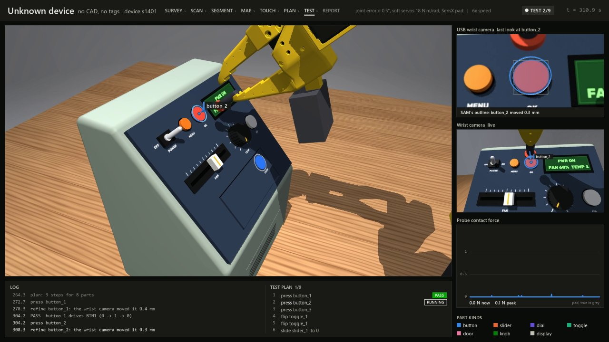
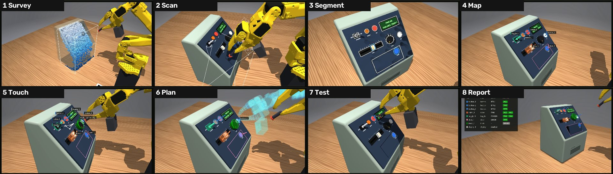

# Robot product tester: the simulation

A robot arm that finds the controls on a device it has never seen, operates them the way a person would, and reports whether the device responded. It needs no CAD model of the device and no markers stuck on it. This folder simulates that robot in MuJoCo, a physics simulator, so the MakeCU team could develop and test it before their SO-101 arm (a low-cost, 3D-printed, six-servo robot arm kit) is built.



## The 3-minute version

**The rig.**

| Part | What it is |
|---|---|
| Arm | An SO-101 with its own gripper and nothing on it. Shut, the jaws' tips are the fingertip that presses; pinch-turns, flips, pick and place open them. `--effector probe` keeps the old 25 mm probe as a sim-only reference |
| Wrist camera | A $19 USB camera, no depth sensing |
| Fingertip sensor | None: force comes from the servos' own feedback |
| Desk board | A printed checkerboard on the desk at a known spot, so each camera can work out where it is relative to the arm. Nothing is stuck on the device itself |

**The task.** Put a device on the desk: a panel of buttons, toggles, sliders, dials, knobs, a door and a display. The robot has to work out what each control is and where it is, operate it, and check the device reacted.

**How it does it,** in eight stages (the strip shows one frame of each from the film):



| Stage | What happens |
|---|---|
| 1 Survey | A few wrist-camera photos from near the home pose show where the device is and which way its control panel faces |
| 2 Scan | The wrist camera photographs the panel from about 12 cm. Each photo gets a partner taken 15 mm to the side, so heights can be measured from how much things shift between the two |
| 3 Segment | The photos are lined up and stitched into one straight-on picture of the panel. Two pretrained image models find and outline every part: OWLv2 draws a box around anything that looks like a control, and SAM traces its outline |
| 4 Map | Each part's height comes from the shift between nearby photos, and simple rules name its kind: round and low is a button, a track with a knob is a slider, and so on |
| 5 Touch | The fingertip taps bare panel to pin down exactly where the panel is, then taps the tops of parts to check their heights |
| 6 Plan | One or two tests per part, after checking the arm can reach it and there's room for the fingertip |
| 7 Test | The wrist camera takes a last look to correct the part's position, then the arm presses, flips, slides, turns or pushes |
| 8 Report | Each part, the device signal it controls, and its result |

**How a test is judged.** In the simulation, every device has a simulated microcontroller that reports the state of each control, like a real appliance's firmware would. A test passes only when that reported state changes the right way, for example the signal for button 1 going 0 → 1 → 0. The robot's own account of what it did never counts. On a real product, the robot would need some way to read that state: by reading the display or indicator lights with its camera, or by wiring the device up. That part isn't built.

There are four outcomes:
- **PASS:** the control did what it should.
- **FAIL:** the arm pushed properly and nothing changed. That would mean the device is faulty.
- **MISSED:** the arm couldn't carry out the test properly. That's the robot's fault, not the device's.
- **REFUSED:** the planner wouldn't try. Knobs are always refused, because turning one needs a pinch grip and the fingertip can only push.

**How well it works.** These results are on the team's earlier setup (the USB camera, servos as soft as the team's, and the old probe with its SensX pad), end to end on 16 devices. That's preset C, a hand-designed demo device, plus 15 procedurally generated ones whose seeds (the numbers that generate them) were set aside and never used for tuning:

| Setup | Tests passed | Devices where every test passed |
|---|---|---|
| Team's setup, with the bench-measured camera and servos (Nov 7) | **124 of 124 (100%)** | 16 of 16 |
| Team's setup, earlier camera and servo model | 119 of 122 (98%) | 14 of 16 |
| Earlier model with ±2° joint calibration error | 104 of 109 (95%) | 12 of 16 |

There were no FAILs and no crashes. Buttons and doors never missed. Toggles were the hardest kind, and pass 20 of 20 since the Nov 7 toggle fix. One device, 1660, is flaky: in three of four runs the scan found none of its parts. [All results](docs/results.md)

Read those numbers with four limits in mind:
- They count only the parts the robot found and attempted. A part it couldn't recognise is skipped and doesn't appear in the count. With calibration error it found 101 parts instead of 109, which is most of why that row has fewer tests.
- Knobs never get tested (see REFUSED above).
- None of the test devices had a broken control, so catching a real fault hasn't been tested yet.
- Everything is simulated, and the arm isn't built yet. The sim models soft servos, gear play and friction, calibration error, the camera's lens and JPEG compression, and the pad's cells. It doesn't model glare, reflections or the variety of real products, so real results will be lower. [Sim vs real](docs/sim-vs-real.md) lists the bench tests that would show by how much.

**Watch it.** Two 2-minute films of the team's setup:
- [`team_setup_presetC_small.mp4`](../../docs/pitch/films/team_setup_presetC_small.mp4): preset C passes 10 of 10 tests.
- [`team_setup_device1401_small.mp4`](../../docs/pitch/films/team_setup_device1401_small.mp4): a generated device passes 8 of 8, and one knob is refused.

These are compressed copies. The full-quality films are 80+ MB each, too big for the repo.

## Dig deeper

| Page | Read it to learn |
|---|---|
| [How it works](docs/how-it-works.md) | Each stage in detail: what it computes, why, and which function does it |
| [Force sensing](docs/sensing.md) | The SensX pad, a load cell, servo feedback alone and an ideal sensor, compared |
| [Results](docs/results.md) | Every benchmark, how it was measured, and what still fails |
| [How we got here](docs/iteration-history.md) | The build, review and fix loop, and the five times the evidence changed the design |
| [Sim vs real](docs/sim-vs-real.md) | What the sim makes easier, and what to measure first on the real arm |
| [The real arm](docs/real-arm.md) | Running the same skills on the built SO-101 through LeRobot: install, first-run checklist, safety, and what isn't built |
| [Code map](docs/code-map.md) | Which file does what, and what's easy to change |
| [The original demo](docs/original-demo.md) | The first sim, which used a CAD model and printed tags (`demo.py`) |

## Run it

Set up a Python environment with uv (a fast Python package manager):

```bash
cd system-1/sim
uv venv --python 3.12 .venv
uv pip install --python .venv -r requirements.txt
```

With an NVIDIA GPU, also install the CUDA build of torch. The image models take 1 to 2 s per image on a laptop GPU and about 45 s on a CPU. The first run downloads OWLv2 (about 620 MB) and SAM 2.1 tiny (about 160 MB) from Hugging Face.

```bash
uv pip install --python .venv torch==2.10.0 torchvision==0.25.0 --index-url https://download.pytorch.org/whl/cu128
```

Then run it. On Windows, `PYTHONUTF8=1` stops the console choking on symbols like ° and σ. On macOS and Linux, use `.venv/bin/python` instead.

```bash
PYTHONUTF8=1 .venv/Scripts/python explore.py --slop --stiffness 18 --sensing current               # the real arm's setup, live viewer
PYTHONUTF8=1 .venv/Scripts/python explore.py --headless --record runs/explore.mp4                  # a film, no window
PYTHONUTF8=1 .venv/Scripts/python tools/bench.py runs/bench.jsonl slop18 1650 --sensing current    # one benchmark run
```

`tools/bench.py` takes an output file, an arm setup (`slop18` means soft servos at 18 N·m/rad; the others are listed in the script) and a device: a seed number, or `C` for preset C.

| Flag | What it changes |
|---|---|
| `--seed N --placement random` | A generated device, placed somewhere else on the desk (default: preset C) |
| `--slop` | Servos as soft as real ones, with the small zone where they don't correct errors and the play in their gears (default: perfectly stiff) |
| `--stiffness NM` | Servo stiffness in N·m/rad with `--slop`. The default is 36; 18 matches the team's servos at the default gain of LeRobot, the software that drives the SO-101 |
| `--sensing tactile` | A SensX 25 pad on the fingertip, with servo feedback for sideways force (needs `--slop`). Modelled for the old probe, so it needs `--effector probe` |
| `--sensing loadcell` | A cheap load cell behind the fingertip instead of the pad (needs `--slop`). Not built |
| `--sensing current` | No sensor at all: force estimated from the servos' own feedback (needs `--slop`) |
| `--ideal` | No camera noise and no joint calibration error |
| `--offsets DEG` | Joint calibration error up to ±DEG on every joint (default: random errors with a standard deviation of 0.5° on the four joints that position the fingertip) |
| `--no-refine` | Skip the camera's last look before each test |
| `--depth [--stereo]` | The earlier version of the pipeline, which used a depth camera on the wrist instead of the USB camera |
| `--real-driver` | The real arm's driver, `RealArm`, drives the sim through a simulated motor bus (needs `--slop`, `--sensing current` or `tactile`, and LeRobot; see [the real arm](docs/real-arm.md#tests)) |

Without `--sensing`, the arm reads the exact simulated contact force (`--sensing perfect`). That's handy for development, but no real sensor works like that (see [Force sensing](docs/sensing.md)).
