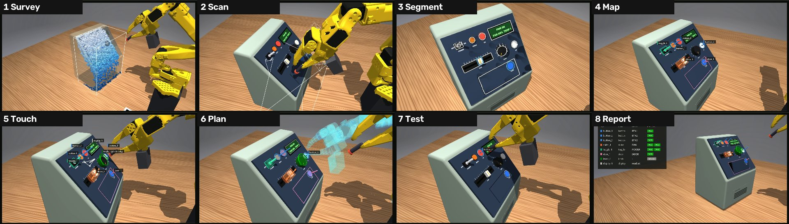
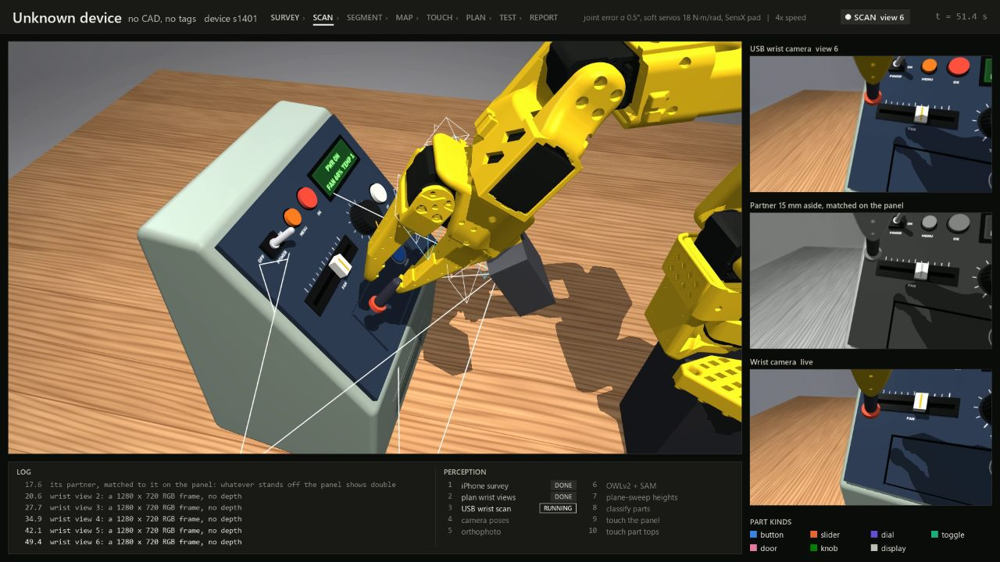
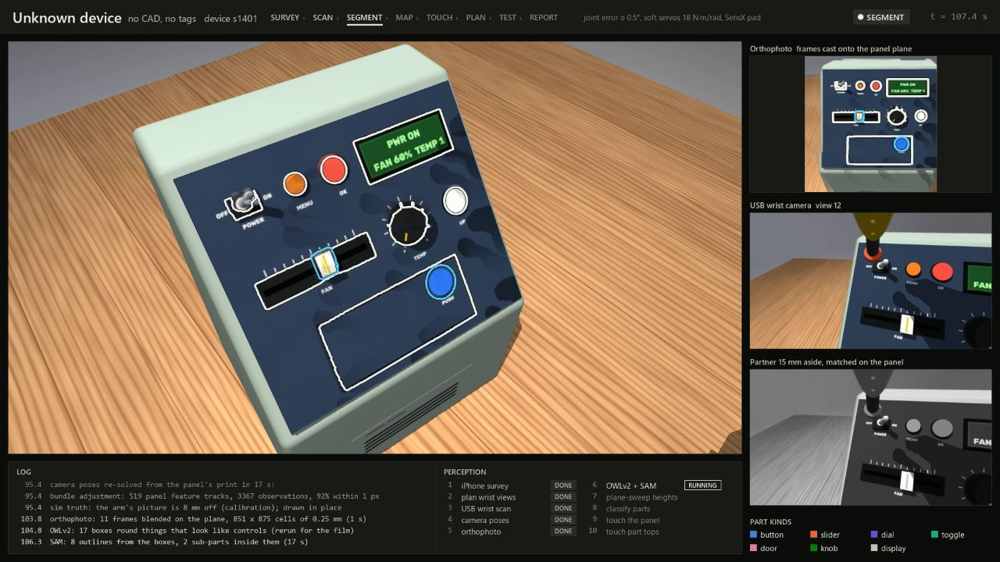
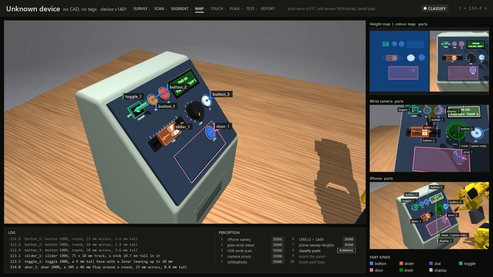
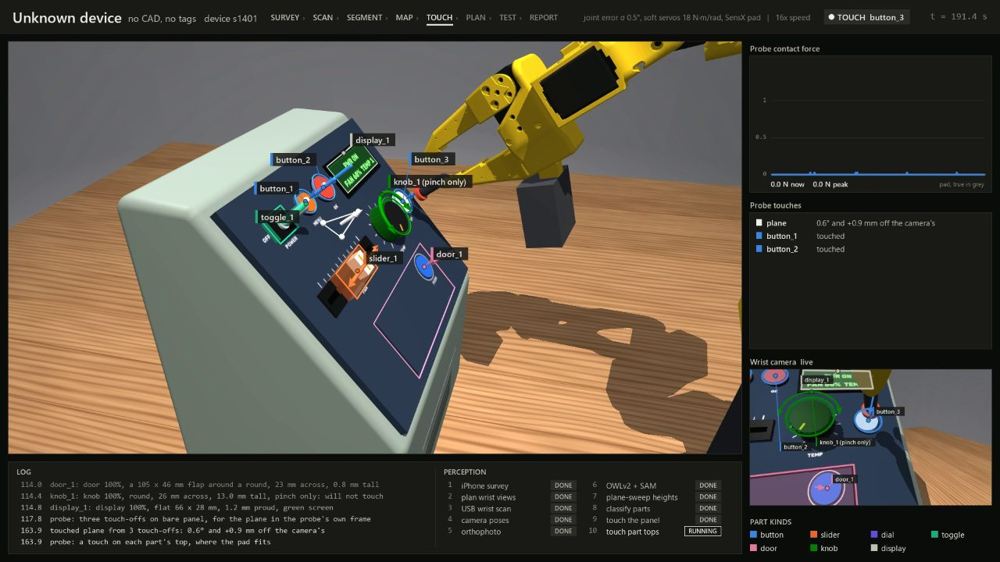
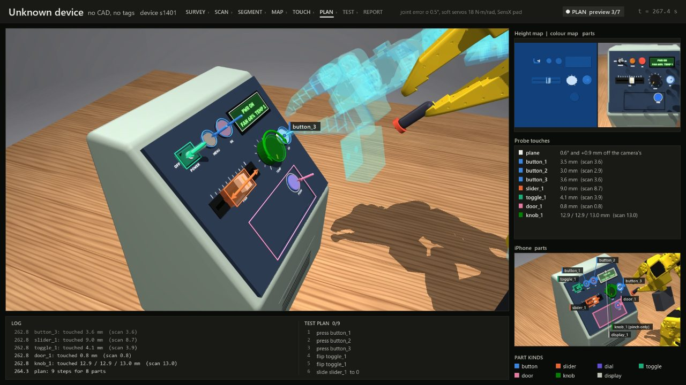
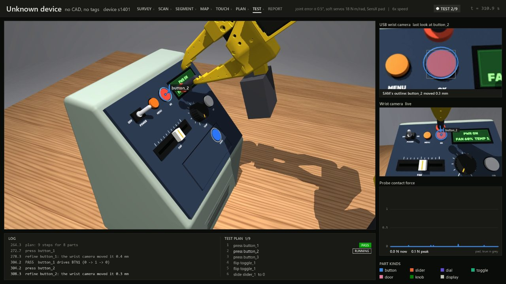
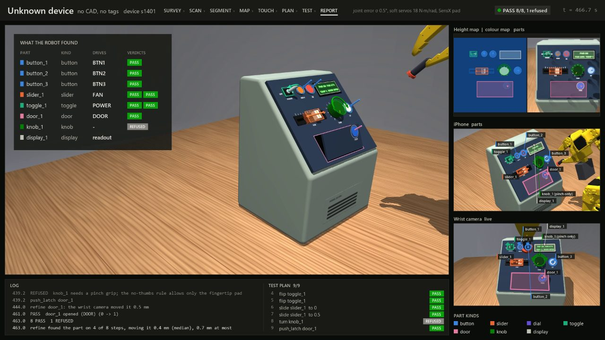

# How it works

[← Back to the overview](../README.md)

The robot is given a device it has never seen: no CAD model, no tags stuck on it, no list of its controls. It has to work out what every control is and where it is, then test each one the way a person would, and say whether the device responded. This page walks through the eight stages in order. Each one names the code that does it, so you can go straight to the source.

The hardware it assumes is the team's planned rig:

| Part | What it is | In the sim |
|---|---|---|
| Arm | SO-101, six serial bus servos (the team's are RobiServo-01, close to a 12 V STS3215) | `robot.py`, with soft servos and gear play when run with `--slop` |
| Fingertip | The fixed jaw's end, a 4 x 3 mm nub, with the gripper held closed | The `tip` site in the arm model. Jaw contacts within 25 mm of it count as the fingertip's |
| Wrist camera | A $19 USB RGB camera (Innomaker U20CAM-1080P, no depth). It is the only camera | `sensors.WristCamera(usb=True)`: 1920x1080, the bench-measured lens, defocus, noise and JPEG |
| Force sensing | What the servos report, with no sensor on the fingertip | `SimArm(sensing="current")`. See [Force sensing](sensing.md) |
| Registration | A ChArUco board (a chessboard printed with square markers) on the desk, at a known spot relative to the arm | `world.py`. It tells each camera where it is relative to the arm. Nothing is stuck on the device itself |

## 1. Survey: where is the device?

The wrist camera takes six photos from near the arm's home pose, panning and raising it a little between them. Features matched across the photos are triangulated with the poses the joint readings give, and the code fits the biggest plane facing the arm through the points above the table: the control panel and its extent. It is good to a degree or two and a centimetre or two, so this stage only decides where the scan should look. The panel's printing gives most of the features, so a plain panel gives too few.

Code: `rgbperceive.survey_wrist`. The depth-camera route (`--depth`) still surveys with the iPhone's LiDAR (`perceive.survey`); the image above is from that route.

## 2. Scan: photograph the panel up close

The arm carries the USB camera to a set of viewpoints about 12 cm from the panel. At each one it takes a photo, then moves 15 mm sideways and takes a partner photo. A single photo has no depth, but two photos from slightly different places do: a part that stands proud of the panel shifts between them more than the panel does. That shift is how the robot measures height without a depth camera.

If a later stage finds a part seen by fewer than two views, the robot goes back for an extra view.

Code: `rgbperceive.perceive_rgb` (stages `views` and `scan`); viewpoints from `perceive.plan_views`.

## 3. Segment: find the parts in the pictures

Three things happen here.

1. **Camera poses are re-solved.** The arm's joint readings say roughly where the camera was, but a degree of joint error moves the picture by millimetres. So the code tracks the panel's own printed features (labels, edges, scale ticks) across all the photos and adjusts every camera pose until those features line up. This is called bundle adjustment. A typical run uses about 500 feature tracks, with over 90% landing within 1 pixel.
2. **The photos are stitched into one straight-on picture** of the panel, called an orthophoto, at 0.25 mm per pixel. It is as if you photographed the panel from directly in front.
3. **Two pretrained image models find the parts.** OWLv2 is an open-vocabulary detector: you give it words ("button", "knob", "dial", "slider", "toggle switch", "lcd display", "door") and it draws boxes around things that look like them. Its labels turned out to be unreliable, so only its boxes are used. SAM 2.1 (Segment Anything) then traces the exact outline of whatever is in each box, and finds sub-parts inside, like a toggle's lever or a door's push pad. Neither model was trained or fine-tuned for this project.

Code: `rgbperceive.analyse`, `rgbperceive.adjust`, `rgbperceive.orthophoto`, `segmodels.py`.

## 4. Map: measure each part and decide what it is

For every outline, a plane sweep measures height. It asks: if this patch of the panel were at height h, would the photos agree? It tries heights from 4 mm below the panel to 24 mm above it, scores how well the photos match at each (a similarity score between image patches called ZNCC), and keeps the best. Done for every pixel inside the outline, that gives the part's height profile: a flat 3 mm cap, a knob 13 mm tall, a lever leaning up to 20 mm.

Then a rule-based classifier names the part from its outline and height profile:

| Looks like | Kind |
|---|---|
| Round and low | Button |
| Round and tall | Knob |
| Round with a fin on top | Dial |
| A long track with a knob in it | Slider |
| A small base with a tall lever | Toggle |
| A large flat flap | Door |
| A flat bright rectangle | Display |

These rules were tuned on one set of generated devices and checked on others (see [How we got here](iteration-history.md)).

Toggles need one extra step. SAM's outline of a toggle includes its lever, which would throw off where the code puts the toggle's pivot, so the outline is first trimmed with a 10 mm round brush that removes the thin lever and keeps the wider base (`rgbperceive._base`). [Why that mattered](iteration-history.md#the-overnight-round-nov-5-to-nov-6).

The result is a list of `features.Part` records: each part's kind, position, orientation, size, and how it moves (a slider slides along an axis, a dial turns about one). That format follows two research papers on describing the movable parts of objects for robots, GAPartNet (CVPR 2023) and SceneFun3D (CVPR 2024).

Code: `rgbperceive.sweep`, `rgbperceive.measure`, `rgbperceive.classify`, the per-kind builders in `perceive.py`, the record in `features.py`.

## 5. Touch: let the fingertip check the camera

Cameras see through the arm's joint readings, and those carry calibration error. The fingertip is on the same arm, so a touch measures positions in exactly the frame the arm will later move in.

- **The panel's plane.** The probe taps bare panel at three spots chosen to keep clear of every part. Three points define the plane. It comes out about 0.2 to 0.3 mm from the truth typically and under 0.6 mm at worst, against 1 to 2 mm typically for the camera's estimate. Two guards catch bad taps. A tap that lands more than 6 mm from the camera's plane is treated as a false contact and replaced with another spot; noisy force sensing produces these. And if the three taps give a plane tilted more than 5° from the camera's, one tap probably landed on the rim of a part, so the tap furthest from the others is dropped and another spot is tried.
- **Part heights.** The probe taps the top of each part where it can do so without pressing it. A touched height replaces the scanned one, unless the two disagree by more than 1.5 mm, in which case the scan's height is kept.

Code: `touch.touch_plane`, `touch.touch_parts`.

## 6. Plan: decide what to test

Each part gets one or two test steps: press each button; flip the toggle both ways; slide the slider to the far end and back to the middle; turn the dial both ways; push the door's latch. The planner refuses steps the rig can't do safely, such as a knob that needs a pinch grip (the fingertip-only, no-thumbs rule) or a part too crowded for the 12 mm pad. In the film, each step's arm pose is previewed as a translucent ghost arm.

Code: `affordances.plan_tests`, `affordances.preview`.

## 7. Test: do it, and check the device responded

Before each step the wrist camera takes a last look from the approach pose. SAM outlines the part in that one frame, and its position is corrected on the touched plane. This last look is done for buttons and doors (`touch.REFINED`). It isn't done for sliders, because the probe hides most of the knob from the slide's starting pose, or for toggles.

Then the skill (the motion routine for that kind of part) runs as a guarded motion. The arm moves to 30 mm in front of the part, moves in slowly, and stops on whichever comes first: the force limit, the planned travel, or an unexpected contact. For a slide or a flip, the push goes sideways once the pad is on the part.

The verdict comes from the device's own readout. In the sim, that's each device's simulated microcontroller, which reports the state of every control. A real product would need its state read another way, for example from its display with the camera:

- **PASS.** The readout changed the expected way, for example `button_1 drives BTN1 (0 -> 1 -> 0)`.
- **FAIL.** The arm pushed properly and nothing changed. That is a finding about the device.
- **MISSED.** The step couldn't test the control, for example because first contact came far from where the part should be. That is a finding about the robot, not the device.
- **REFUSED.** The planner wouldn't try.

A safety layer under every motion stops the arm if the force goes over 15 N, if any part of the arm other than the jaws' last 25 mm touches anything, or if a command would leave the joint limits or the workspace.

Code: `touch.make_refine` (the last look), `affordances.run_plan` and the skills in `affordances.py`, motion primitives in `skills.py`, the safety layer in `robot.SimArm.tick`.

## 8. Report

A table of every part found: its kind, the readout channel it drives (BTN1, FAN, POWER, DOOR, ...), and its verdicts.

## The film

`explore.py` runs all of this and directs a camera around it, with a dashboard showing the log, the stage checklist, the camera feeds and the force plot. Two things in the film use knowledge the robot never has: shots are framed on the device's true extent, and when the arm has calibration error the overlay is drawn in the true place, with a note on screen saying how far off the arm's own picture is.

Next: [Force sensing](sensing.md) · [Results](results.md) · [How we got here](iteration-history.md) · [Sim vs real](sim-vs-real.md) · [Code map](code-map.md)
